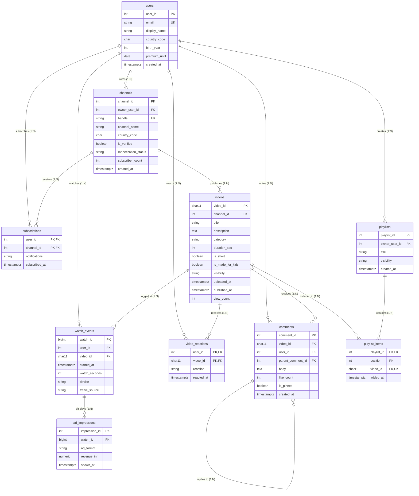

# Phase 2: Schema Design & Data Architecture

**Course:** DBMS Project · **Team:** T0006 · **Section:** D  
**File:** `docs/02_schema_design.md` · **Target:** Checkpoint 1

---

## 1. Schema Overview

The database is built inside the `youtube` schema. It models YouTube's core operations: users, creator channels, video uploads, playlists, subscriptions, views (watch events), reactions (likes/dislikes), comments, and ad revenue tracking.

The schema uses strict primary keys, foreign keys with explicit deletion rules (`ON DELETE CASCADE` and `ON DELETE SET NULL`), and 23 custom `CHECK` constraints to enforce business rules directly at the database level.

---

## 2. Entity-Relationship (ER) Diagram

A full vector diagram is saved at [diagrams/er_diagram.svg](file:///Users/ritammishranst/Desktop/DBMS-YouTube-Video-Sharing/diagrams/er_diagram.svg).

Below is the complete entity-relationship model:



---

## 3. Data Dictionary

### Table 1: `users`
Represents registered users.

| Column | Data Type | Nullable | Constraints | Why this type and constraint |
|---|---|:---:|---|---|
| `user_id` | `INT GENERATED BY DEFAULT AS IDENTITY` | No | `PRIMARY KEY` | Unique numeric identifier for each user. |
| `email` | `VARCHAR(255)` | No | `UNIQUE`, `NOT NULL` | Standard email length; emails must be unique for login. |
| `display_name` | `VARCHAR(100)` | No | `NOT NULL` | User full name or handle. |
| `country_code` | `CHAR(2)` | No | `NOT NULL`, `CHECK(length = 2)` | ISO 3166-1 alpha-2 standard country codes (e.g., IN, US). |
| `birth_year` | `INT` | Yes | `CHECK(1900 to 2026)` | Optional for privacy; checks realistic birth year range. |
| `premium_until` | `DATE` | Yes | None | Expiration date of YouTube Premium plan; `NULL` for free users. |
| `created_at` | `TIMESTAMPTZ` | No | `NOT NULL` | Registration timestamp with timezone for accurate audit. |

---

### Table 2: `channels`
Represents creator profiles owned by registered users.

| Column | Data Type | Nullable | Constraints | Why this type and constraint |
|---|---|:---:|---|---|
| `channel_id` | `INT GENERATED BY DEFAULT AS IDENTITY` | No | `PRIMARY KEY` | Unique channel identifier. |
| `owner_user_id` | `INT` | No | `FK -> users(user_id) ON DELETE CASCADE` | Every channel belongs to a user; deletes channel if user account is deleted. |
| `handle` | `VARCHAR(60)` | No | `UNIQUE`, `CHECK(handle LIKE '@%')` | YouTube handles must start with `@` and be globally unique. |
| `channel_name` | `VARCHAR(150)` | No | `NOT NULL` | Name shown on channel banner and video watch pages. |
| `country_code` | `CHAR(2)` | No | `NOT NULL`, `CHECK(length = 2)` | Geographic location of the channel. |
| `is_verified` | `BOOLEAN` | No | `DEFAULT FALSE` | Verification badge flag. |
| `monetization_status` | `VARCHAR(20)` | No | `CHECK IN ('ELIGIBLE', 'NOT_ELIGIBLE', 'SUSPENDED')` | Controls whether channel can show ads and earn revenue. |
| `subscriber_count` | `INT` | No | `DEFAULT 0`, `CHECK(>= 0)` | Denormalized count of current subscribers (avoids full table count on page loads). |
| `created_at` | `TIMESTAMPTZ` | No | `NOT NULL` | Channel registration timestamp with timezone. |

---

### Table 3: `videos`
Represents all video content (standard long videos and Shorts).

| Column | Data Type | Nullable | Constraints | Why this type and constraint |
|---|---|:---:|---|---|
| `video_id` | `CHAR(11)` | No | `PRIMARY KEY`, `CHECK(length = 11)` | YouTube uses 11-character base64 alphanumeric video identifiers. |
| `channel_id` | `INT` | No | `FK -> channels(channel_id) ON DELETE CASCADE` | Channel that published the video; cascades on channel deletion. |
| `title` | `VARCHAR(255)` | No | `NOT NULL` | Video headline. |
| `description` | `TEXT` | Yes | None | Optional text box; can be long and contain links/timestamps. |
| `category` | `VARCHAR(30)` | No | `CHECK IN (10 categories)` | Strict set: Comedy, Cooking, Education, Film, Gaming, Music, News, Sports, Tech, Vlogs. |
| `duration_sec` | `INT` | No | `CHECK(duration_sec > 0)` | Video length in seconds; must be strictly positive. |
| `is_short` | `BOOLEAN` | No | `NOT NULL` | Flags short-form vertical video. |
| `is_made_for_kids` | `BOOLEAN` | No | `DEFAULT FALSE` | Compliance flag for child protection laws. |
| `visibility` | `VARCHAR(20)` | No | `CHECK IN ('PRIVATE', 'PUBLIC', 'SCHEDULED', 'UNLISTED')` | Access control status. |
| `uploaded_at` | `TIMESTAMPTZ` | No | `NOT NULL` | Ingestion timestamp. |
| `published_at` | `TIMESTAMPTZ` | Yes | None | Time video became viewable; `NULL` for private videos. |
| `view_count` | `INT` | No | `DEFAULT 0`, `CHECK(>= 0)` | Denormalized view counter. |

**Cross-Column Constraints on `videos`:**
1. `chk_videos_shorts_duration`: A video marked as Short must be 60 seconds or less:  
   `CHECK ((is_short = TRUE AND duration_sec <= 60) OR (is_short = FALSE AND duration_sec > 60))`
2. `chk_videos_private_published`: Private videos never have a publish timestamp:  
   `CHECK ((visibility = 'PRIVATE' AND published_at IS NULL) OR (visibility <> 'PRIVATE' AND published_at IS NOT NULL))`

---

### Table 4: `subscriptions`
Represents users following creator channels.

| Column | Data Type | Nullable | Constraints | Why this type and constraint |
|---|---|:---:|---|---|
| `user_id` | `INT` | No | `PK`, `FK -> users(user_id) ON DELETE CASCADE` | Subscriber. |
| `channel_id` | `INT` | No | `PK`, `FK -> channels(channel_id) ON DELETE CASCADE` | Followed channel. |
| `notifications` | `VARCHAR(20)` | No | `CHECK IN ('ALL', 'NONE', 'PERSONALIZED')` | Notification bell status. |
| `subscribed_at` | `TIMESTAMPTZ` | No | `NOT NULL` | Timestamp subscription occurred. |

*Primary Key:* Composite `(user_id, channel_id)` prevents a user from subscribing to the same channel multiple times.

---

### Table 5: `watch_events`
Logs playback sessions from both signed-in users and anonymous visitors.

| Column | Data Type | Nullable | Constraints | Why this type and constraint |
|---|---|:---:|---|---|
| `watch_id` | `BIGINT` | No | `PRIMARY KEY` | High-volume sequential event identifier (expected to grow into billions). |
| `user_id` | `INT` | Yes | `FK -> users(user_id) ON DELETE SET NULL` | Signed-in viewer; `NULL` for anonymous guest views. `SET NULL` preserves view history even if a user deletes their account. |
| `video_id` | `CHAR(11)` | No | `FK -> videos(video_id) ON DELETE CASCADE` | Video being watched. |
| `started_at` | `TIMESTAMPTZ` | No | `NOT NULL` | Playback initiation time with timezone. |
| `watch_seconds` | `INT` | No | `CHECK(watch_seconds >= 0)` | Playback duration logged. |
| `device` | `VARCHAR(20)` | No | `CHECK IN ('ANDROID', 'IOS', 'TV', 'WEB')` | Playback hardware/client. |
| `traffic_source` | `VARCHAR(20)` | No | `CHECK IN ('EXTERNAL', 'HOME', 'SEARCH', 'SHORTS_FEED', 'SUBSCRIPTION', 'SUGGESTED')` | Analytics referrer. |

---

### Table 6: `video_reactions`
Tracks likes and dislikes.

| Column | Data Type | Nullable | Constraints | Why this type and constraint |
|---|---|:---:|---|---|
| `user_id` | `INT` | No | `PK`, `FK -> users(user_id) ON DELETE CASCADE` | Reacting user. |
| `video_id` | `CHAR(11)` | No | `PK`, `FK -> videos(video_id) ON DELETE CASCADE` | Target video. |
| `reaction` | `VARCHAR(10)` | No | `CHECK IN ('LIKE', 'DISLIKE')` | Binary sentiment. |
| `reacted_at` | `TIMESTAMPTZ` | No | `NOT NULL` | Timestamp reaction was recorded. |

*Primary Key:* Composite `(user_id, video_id)` enforces that a user can only have one reaction on a video at any given time.

---

### Table 7: `comments`
User comments and threaded replies.

| Column | Data Type | Nullable | Constraints | Why this type and constraint |
|---|---|:---:|---|---|
| `comment_id` | `INT GENERATED BY DEFAULT AS IDENTITY` | No | `PRIMARY KEY` | Unique comment ID. |
| `video_id` | `CHAR(11)` | No | `FK -> videos(video_id) ON DELETE CASCADE` | Video comment section. |
| `user_id` | `INT` | No | `FK -> users(user_id) ON DELETE CASCADE` | Comment author. |
| `parent_comment_id` | `INT` | Yes | `FK -> comments(comment_id) ON DELETE CASCADE` | Points to parent comment for replies; `NULL` for top-level comments. |
| `body` | `TEXT` | No | `NOT NULL` | Comment text content. |
| `like_count` | `INT` | No | `DEFAULT 0`, `CHECK(>= 0)` | Aggregate likes on comment. |
| `is_pinned` | `BOOLEAN` | No | `DEFAULT FALSE` | Creator pin feature. |
| `created_at` | `TIMESTAMPTZ` | No | `NOT NULL` | Post timestamp. |

*Cross-Column Constraint:* `CHECK (is_pinned = FALSE OR parent_comment_id IS NULL)` ensures only top-level comments can be pinned (replies cannot be pinned).

---

### Table 8: `playlists`
Curated lists created by users.

| Column | Data Type | Nullable | Constraints | Why this type and constraint |
|---|---|:---:|---|---|
| `playlist_id` | `INT GENERATED BY DEFAULT AS IDENTITY` | No | `PRIMARY KEY` | Unique playlist ID. |
| `owner_user_id` | `INT` | No | `FK -> users(user_id) ON DELETE CASCADE` | Playlist creator. |
| `title` | `VARCHAR(150)` | No | `NOT NULL` | Playlist name. |
| `visibility` | `VARCHAR(20)` | No | `CHECK IN ('PRIVATE', 'PUBLIC', 'UNLISTED')` | Access privacy. |
| `created_at` | `TIMESTAMPTZ` | No | `NOT NULL` | Creation timestamp. |

---

### Table 9: `playlist_items`
Ordered videos inside playlists.

| Column | Data Type | Nullable | Constraints | Why this type and constraint |
|---|---|:---:|---|---|
| `playlist_id` | `INT` | No | `PK`, `FK -> playlists(playlist_id) ON DELETE CASCADE` | Parent playlist. |
| `position` | `INT` | No | `PK`, `CHECK(position >= 1)` | Sequence order (1-indexed). |
| `video_id` | `CHAR(11)` | No | `UNIQUE(playlist_id, video_id)`, `FK -> videos(video_id) ON DELETE CASCADE` | Video reference. |
| `added_at` | `TIMESTAMPTZ` | No | `NOT NULL` | Addition timestamp. |

*Primary Key & Uniqueness:* `(playlist_id, position)` ensures order uniqueness; `UNIQUE(playlist_id, video_id)` prevents the same video from appearing twice in the same playlist.

---

### Table 10: `ad_impressions`
Logs ad views shown during playback events.

| Column | Data Type | Nullable | Constraints | Why this type and constraint |
|---|---|:---:|---|---|
| `impression_id` | `INT GENERATED BY DEFAULT AS IDENTITY` | No | `PRIMARY KEY` | Unique ad impression ID. |
| `watch_id` | `BIGINT` | No | `FK -> watch_events(watch_id) ON DELETE CASCADE` | Watch session during which the ad was served. |
| `ad_format` | `VARCHAR(20)` | No | `CHECK IN ('MIDROLL', 'PREROLL')` | Video ad delivery slot. |
| `revenue_inr` | `NUMERIC(8, 4)` | No | `CHECK(revenue_inr >= 0)` | Accurate financial decimal (avoids floating point rounding errors). |
| `shown_at` | `TIMESTAMPTZ` | No | `NOT NULL` | Timestamp the ad impression occurred. |

---

## 4. Normal Form & Functional Dependency (FD) Analysis

### 1NF (First Normal Form)
- All attribute values are atomic (no repeating groups, arrays, or comma-separated lists).
- Every table has a clearly defined primary key.

### 2NF (Second Normal Form)
- Satisfies 1NF.
- In tables with composite primary keys (`subscriptions`, `video_reactions`, `playlist_items`), all non-key attributes depend on the **whole primary key**, not a partial subset:
  - In `subscriptions`: `notifications` and `subscribed_at` depend on `(user_id, channel_id)`.
  - In `video_reactions`: `reaction` and `reacted_at` depend on `(user_id, video_id)`.
  - In `playlist_items`: `video_id` and `added_at` depend on `(playlist_id, position)`.

### 3NF (Third Normal Form) & BCNF
- Satisfies 2NF.
- There are no transitive dependencies ($X \to Y \to Z$ where $Y$ is not a candidate key) among non-key attributes.
- In all functional dependencies $X \to Y$, the determinant $X$ is a superkey:
  - `users`: `user_id -> email, display_name, country_code, birth_year, premium_until, created_at`
  - `channels`: `channel_id -> owner_user_id, handle, channel_name, country_code, is_verified, monetization_status, subscriber_count, created_at`
  - `videos`: `video_id -> channel_id, title, description, category, duration_sec, is_short, is_made_for_kids, visibility, uploaded_at, published_at, view_count`
  - `watch_events`: `watch_id -> user_id, video_id, started_at, watch_seconds, device, traffic_source`
  - `comments`: `comment_id -> video_id, user_id, parent_comment_id, body, like_count, is_pinned, created_at`
  - `playlists`: `playlist_id -> owner_user_id, title, visibility, created_at`
  - `ad_impressions`: `impression_id -> watch_id, ad_format, revenue_inr, shown_at`

### Discussion of Denormalized / Redundant Columns
The schema intentionally retains three derived columns for performance reasons:
1. **`channels.subscriber_count`**: Derived from `COUNT(subscriptions WHERE channel_id = ...)`. Storing this counter avoids running an expensive aggregate query over 129,000+ subscription rows every time a channel page or video card is viewed.
2. **`videos.view_count`**: Derived from `COUNT(watch_events WHERE video_id = ...)`. Aggregating across 200,000+ (and eventually 4M+) watch events on every video page load would crush database throughput.
3. **`videos.is_short`**: Dependent on `duration_sec <= 60`. Storing this boolean flag allows fast filtering for Shorts recommendation shelves without re-evaluating expressions on each query.

---

## 5. Integrity Check Results

We executed the 3 mandatory integrity checks on the loaded seed data. All 3 tests returned **0 violations**, proving the data is clean:

```sql
-- Check 1: Watch duration never exceeds video duration
SELECT count(*) AS violations_watch_longer_than_video
FROM watch_events w
JOIN videos v ON w.video_id = v.video_id
WHERE w.watch_seconds > v.duration_sec;
-- Result: 0

-- Check 2: Nobody watched a video before it was uploaded
SELECT count(*) AS violations_watch_before_upload
FROM watch_events w
JOIN videos v ON w.video_id = v.video_id
WHERE w.started_at < v.uploaded_at;
-- Result: 0

-- Check 3: A playlist does not contain the same video twice
SELECT count(*) AS violations_duplicate_playlist_videos
FROM (
    SELECT playlist_id, video_id
    FROM playlist_items
    GROUP BY playlist_id, video_id
    HAVING count(*) > 1
) dupes;
-- Result: 0
```

---

## 6. Real Data Problems Discovered in Seed Data

During our exploratory analysis of the seed data exports, we uncovered several key insights and anomalies:

1. **Guest Viewers (NULL `user_id`):**
   In `watch_events.csv`, exactly **49,964 out of 200,000 views (24.98%)** have an empty `user_id` because users watched videos without logging in.
   * *Critical Impact:* Query `R13` uses `WHERE s.user_id NOT IN (SELECT w.user_id ...)`. Because the subquery returns rows with `NULL`, SQL three-valued logic causes `NOT IN` to evaluate to `UNKNOWN` (false), making the report always return 0 rows. This explains Problem statement P5!

2. **Premium Ad Violations (Query `R25`):**
   In `ad_impressions.csv`, **181 ad impressions** were served to users who held an active YouTube Premium plan at the time of playback (`premium_until >= shown_at::date`). This indicates a bug in the ad-serving service that needs remediation.

3. **Child Safety Compliance Issues (Query `R18`):**
   There are **1,007 comments** logged across **397 videos** flagged as `is_made_for_kids = true`. By platform policy and child safety regulations, comments must be completely disabled on kids' content.

4. **Private Video Publishing Rules:**
   All 1,526 private videos have an empty `published_at` (`NULL`), whereas all public, scheduled, and unlisted videos have a valid timestamp. We codified this into table constraint `chk_videos_private_published`.

5. **Pinning Rules for Replies:**
   All 7,390 reply comments (`parent_comment_id IS NOT NULL`) have `is_pinned = false`. Only top-level comments are ever pinned by creators, which we enforced using constraint `chk_comments_pinned_reply`. 